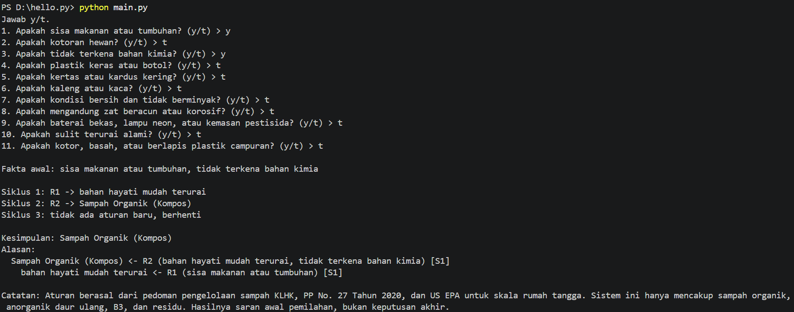
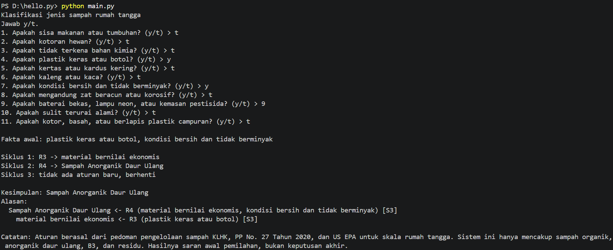
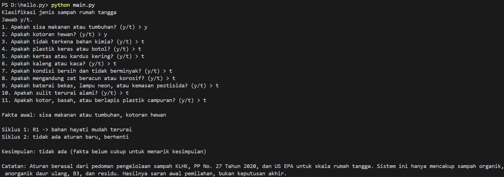

# Sistem Pakar Klasifikasi Jenis Sampah Rumah Tangga

* **Nama:** [Adelya Ega Syafa]
* **NIM:** [F1D02510033]
* **Mata Kuliah:** Kecerdasan Buatan

---

## 1. Topik dan Cara Menjalankan Program
* **Topik:** Klasifikasi Jenis Sampah Rumah Tangga (Organik, Anorganik Daur Ulang, B3, dan Residu).
* **Bahasa Pemrograman:** Python 3 (menggunakan pustaka bawaan `json`, tanpa perlu instalasi library tambahan).
* **Cara Menjalankan:**
  1. Pastikan file `main.py` dan `kb_sampah.json` berada di dalam satu folder yang sama.
  2. Buka terminal atau command prompt pada folder tersebut, lalu jalankan perintah:
     ```bash
     python main.py
     ```

---

## 2. Daftar Sumber dan Basis Aturan

### Daftar Sumber
1. **[S1]** Kementerian Lingkungan Hidup dan Kehutanan (KLHK), *"Pedoman Pemilahan Sampah dari Sumber"*, Direktorat Penanganan Sampah KLHK RI, https://sipsn.menlhk.go.id, diakses 14 Nov 2026.
2. **[S2]** Pemerintah Republik Indonesia, *"Peraturan Pemerintah RI Nomor 27 Tahun 2020 tentang Pengelolaan Sampah Spesifik (Sampah B3 Rumah Tangga)"*, Badan Pemeriksa Keuangan RI, https://peraturan.bpk.go.id, diakses 14 Nov 2026.
3. **[S3]** US Environmental Protection Agency (EPA), *"How Do I Recycle?: Common Recyclables"*, https://www.epa.gov/recycle/how-do-i-recycle-common-recyclables, diakses 14 Nov 2026.

### Tabel Aturan IF-THEN
| ID | IF (Premis) | Mode | THEN (Konklusi) | Sumber |
| :--- | :--- | :---: | :--- | :---: |
| **R1** | sisa makanan atau tumbuhan **OR** kotoran hewan | `atau` | bahan hayati mudah terurai | S1 |
| **R2** | bahan hayati mudah terurai **AND** tidak terkena bahan kimia | `dan` | **sampah organik (kompos)** | S1 |
| **R3** | plastik keras atau botol **OR** kertas atau kardus kering **OR** kaleng atau kaca | `atau` | material bernilai ekonomis | S3 |
| **R4** | material bernilai ekonomis **AND** kondisi bersih dan tidak berminyak | `dan` | **sampah anorganik daur ulang** | S3 |
| **R5** | mengandung zat beracun atau korosif **OR** baterai bekas, lampu neon, atau kemasan pestisida | `atau` | **sampah B3 (berbahaya dan beracun)** | S2 |
| **R6** | sulit terurai alami **AND** kotor, basah, atau berlapis plastik campuran | `dan` | **sampah residu (buang ke TPA)** | S1 |

*(Catatan: R1 dan R3 menghasilkan fakta antara yang digunakan sebagai syarat pada aturan R2 dan R4).*

---

## 3. Metode Inferensi yang Dipilih
Program ini menggunakan metode **Forward Chaining (FC)**.
* **Alasan Pemilihan:** Proses klasifikasi sampah dimulai dari pengamatan ciri fisik sampah yang ditemukan pengguna (fakta awal), kemudian sistem mencocokkan fakta tersebut secara bertahap dengan aturan yang tersedia di basis pengetahuan hingga menarik kategori sampah sebagai kesimpulan akhir.

---

## 4. Kasus Uji dan Screenshot

### Kasus Uji 1 (Positif — Sampah Organik)
* **Input (`y`):** `sisa makanan atau tumbuhan`, `tidak terkena bahan kimia`
* **Kesimpulan:** `sampah organik (kompos)` (melalui rantai aturan R1 → R2)
* **Screenshot:**
  

### Kasus Uji 2 (Positif — Multi-Kesimpulan: Anorganik Daur Ulang & B3)
* **Input (`y`):** `plastik keras atau botol`, `kondisi bersih dan tidak berminyak`, `baterai bekas, lampu neon, atau kemasan pestisida`
* **Kesimpulan:** `sampah anorganik daur ulang`, `sampah B3 (berbahaya dan beracun)` (melalui aturan R3 → R4 dan R5)
* **Screenshot:**
  

### Kasus Uji 3 (Negatif — Tidak Menghasilkan Kesimpulan)
* **Input (`y`):** `sisa makanan atau tumbuhan`, `kotoran hewan` (tanpa konfirmasi bebas bahan kimia)
* **Kesimpulan:** Tidak ada (berhenti setelah R1 menghasilkan `bahan hayati mudah terurai` karena syarat R2 tidak terpenuhi).
* **Screenshot:**
  

---

## 5. Batas Keberlakuan
Aturan berasal dari pedoman pengelolaan sampah KLHK, PP No. 27 Tahun 2020, dan US EPA untuk skala rumah tangga. Sistem ini hanya mencakup sampah organik, anorganik daur ulang, B3, dan residu sebagai saran awal pemilahan, bukan keputusan akhir untuk audit limbah industri atau medis.

---

## 6. Penggunaan Alat Bantu AI
Menggunakan alat bantu AI (Gemini) untuk membantu memperbaiki eror pada struktur kode Python dasar, merapikan format penulisan aturan IF-THEN ke dalam file JSON, serta menyusun draf dokumentasi README. Seluruh program telah dijalankan, diuji secara mandiri, dan dipahami alur logikanya.
